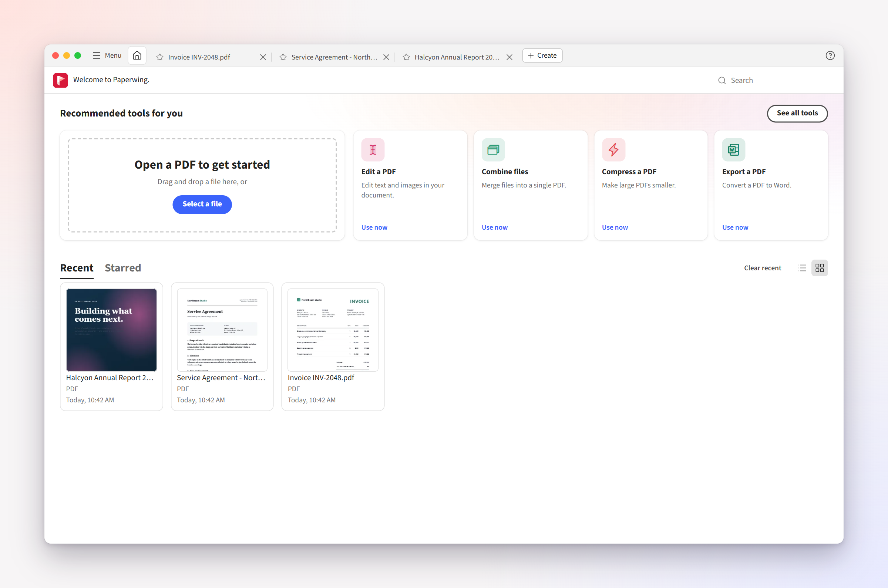
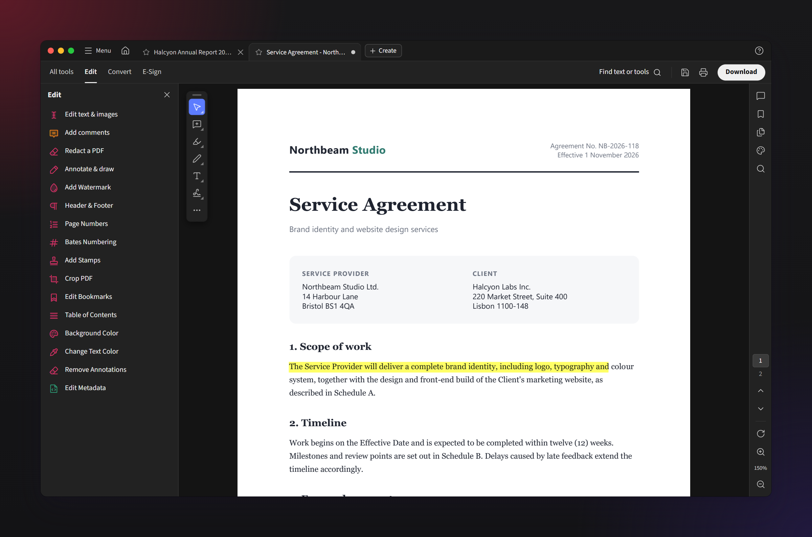
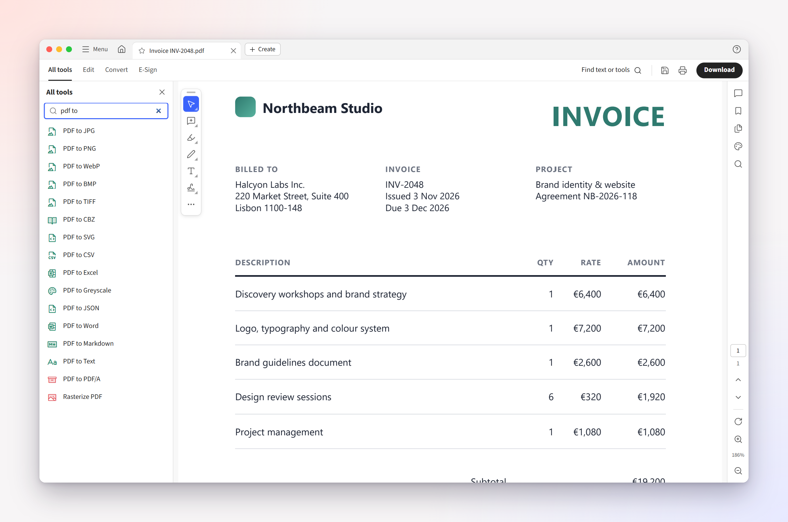
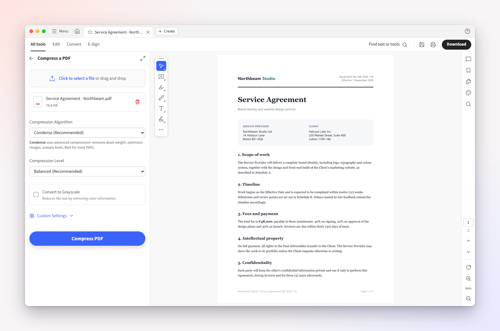
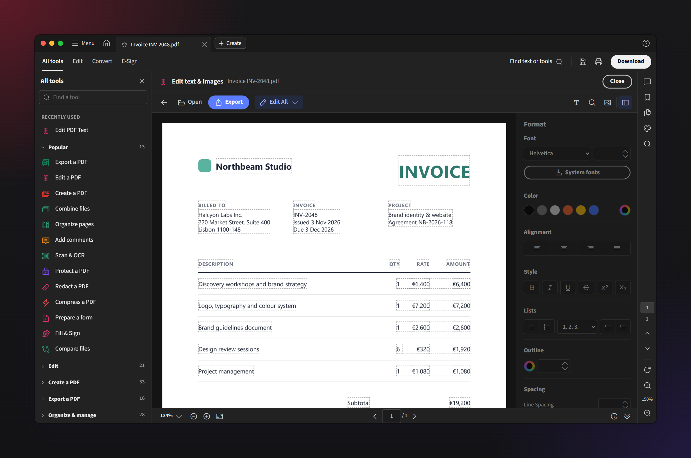
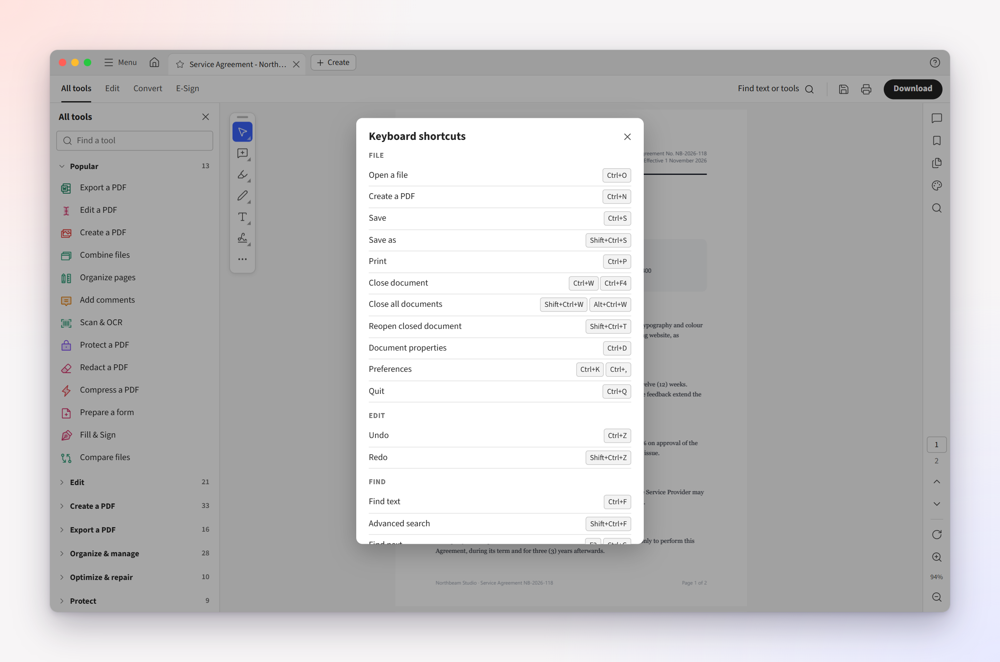

<div align="center">


# Paperwing

**The free, open-source alternative to Adobe Acrobat for Windows and macOS.**

Edit, sign, convert, organize, compress and protect PDFs in a familiar desktop workspace —
offline, with no account, no subscription and no upsells.

Built by [Rohan Vijaykumar](https://rohanvijaykumar.cv)

[](https://github.com/rohanvijaykumar/paperwing/releases/latest)
[](#download)
[](LICENSE)
[](https://github.com/alam00000/bentopdf)

<a href="https://www.producthunt.com/products/paperwing-2?embed=true&amp;utm_source=badge-featured&amp;utm_medium=badge&amp;utm_campaign=badge-paperwing-2" target="_blank" rel="noopener noreferrer"></a>

<br />


</div>

---

## Why Paperwing?

If you've used Acrobat, you already know how to use Paperwing: the same tabbed workspace,
**All tools** panel, **Edit / Convert / E-Sign** tabs, floating quick-action toolbar and right-hand
navigation rail — and the same keyboard shortcuts.

What you won't find: sign-in prompts, cloud nags, trial pop-ups, AI overlays, paywalled buttons or a
monthly bill. Every feature is free, and your files never leave your computer.

|                                              | Paperwing          | Acrobat Pro  |
| -------------------------------------------- | ------------------ | ------------ |
| Price                                        | **Free, forever**  | Subscription |
| Account required                             | **No**             | Yes          |
| Works offline                                | **Yes**¹           | Partly       |
| Upsell / AI pop-ups                          | **None**           | Frequent     |
| Open source                                  | **Yes (AGPL-3.0)** | No           |
| Portable (no install) on Windows             | **Yes**            | No           |
| Familiar Acrobat-style workspace & shortcuts | **Yes**            | —            |

¹ A few tools fetch their engine once on first use; see [Privacy](#privacy).

> Paperwing is an independent project and is not affiliated with or endorsed by Adobe.
> See [Trademarks](#trademarks).

## Features

**A complete PDF workspace**

- Tabbed documents and a Home view with recent and starred files, shown with a preview of their first page
- A searchable **All tools** sidebar: every tool, grouped like Acrobat's, with pinned and recently used tools on top
- Every tool opens right beside your document — no separate tool pages
- Floating quick-action toolbar: select, comment, highlight, draw, text box, sign, shapes, stamps
- Right rail with comments, bookmarks, page thumbnails, find, page navigation, rotate and zoom (pick a level or type any percentage)
- **Light and dark themes** that follow your system automatically (neutral, Acrobat-style dark mode)

**100+ tools from [BentoPDF](https://github.com/alam00000/bentopdf)**

- **Edit** — edit text & images, annotate, redact, watermarks, headers & footers, page numbers, Bates numbering, bookmarks, stamps, crop
- **Convert** — PDF to Word, Excel, images, text, Markdown, JSON; Word, Excel, PowerPoint, images, ebooks, email, Markdown and 30+ formats to PDF
- **Organize** — combine, split, reorder, rotate, insert, delete and extract pages; N-up, booklets, attachments, layers
- **E-Sign & forms** — fill & sign, digital certificates, signature validation, timestamps, create and fill forms
- **Optimize & protect** — compress, OCR, repair, PDF/A, encrypt, remove restrictions, sanitize, flatten, compare documents

**Designed around Acrobat's most common complaints**

- 🔒 **Private by default** — everything runs locally; no account, telemetry or uploads
- ⚡ **Fast and light** — opens in about a second, scrolls at a steady 60 fps, and restores your last session without loading every document up front
- 🖼️ **PDF thumbnails in File Explorer** (Windows) while Paperwing is your default PDF app
- ⌨️ **Acrobat shortcuts** — including the single-key tool accelerators (H, V, S, U, D, X…), on by default
- 🔎 **Command palette** — <kbd>Ctrl</kbd>+<kbd>Shift</kbd>+<kbd>P</kbd> finds any tool or command instantly
- 📌 **Pin your tools** — pinned and recently used tools sit at the top of the tools panel
- 💾 **Never lose work** — unsaved-change markers, save prompts on close, session restore, and
  recovery of documents a tool made but you hadn't saved yet if the app closes unexpectedly
- 📍 **Pick up where you left off** — documents reopen at the page and zoom you left them at
- 📚 **Batch tools** — run Compress, Flatten, PDF to Word and other tools on many files at once
- 🔄 **Updates itself** (Windows installer): new versions download in the background
- ↩️ **Reopen closed tab** — <kbd>Ctrl</kbd>+<kbd>Shift</kbd>+<kbd>T</kbd>, just like your browser
- 🧪 **Non-destructive tools** — results open in a new tab; your original stays untouched until you save
- 🗂️ **Native file dialogs** and real "Save" back to the original file
- 🎒 **Portable mode** on Windows — run from a USB stick with settings stored next to the app

## Download

Get the latest version from the **[Releases page](https://github.com/rohanvijaykumar/paperwing/releases/latest)**.

| Platform                  | File                                       | Notes                                                               |
| ------------------------- | ------------------------------------------ | ------------------------------------------------------------------- |
| **Windows** — installer   | `Paperwing-Setup-<version>-x64.exe`        | Start-menu entry, file association, uninstaller                     |
| **Windows** — portable    | `Paperwing-Portable-<version>-win-x64.zip` | Unzip anywhere and run `Paperwing.exe`; settings stay in the folder |
| **macOS** — Apple Silicon | `Paperwing-<version>-mac-arm64.dmg`        | M1 / M2 / M3 / M4 Macs                                              |
| **macOS** — Intel         | `Paperwing-<version>-mac-x64.dmg`          | Intel Macs                                                          |

Paperwing isn't code-signed yet, so Windows SmartScreen and macOS Gatekeeper will warn the first time
you open it. See **[Installation](docs/INSTALL.md)** for the one-time steps.

## FAQ

**Do I need to install LibreOffice for Word, Excel and PowerPoint conversions?**

No. The conversion engine isn't in the installer, to keep the download small, but you don't install
anything yourself: the first time you convert an Office file, Paperwing downloads it once (about
75 MB) from this repository's GitHub Releases and verifies it against a SHA-256 hash.

**Does redaction actually remove the content, or just draw a box over it?**

It removes it. When you apply a redaction, the text and graphics under the marked area are deleted
from the page itself, not just covered. Redaction doesn't touch the document's metadata (author,
title and so on); use the **Sanitize** tool to strip that too.

**Why does Windows or macOS warn me when I open it?**

Paperwing isn't code-signed yet. The warning appears for any unsigned app; the full source is here,
and you can [build it yourself](#build-from-source).

**Does it work offline?**

Yes, apart from the one-time engine downloads listed under [Privacy](#privacy).

## Screenshots

<table>
  <tr>
    <td width="50%"><br /><sub><b>Home</b> — recent and starred files with page previews</sub></td>
    <td width="50%"><br /><sub><b>Dark mode</b> — follows your system automatically</sub></td>
  </tr>
  <tr>
    <td><br /><sub><b>All tools sidebar</b> — search and browse every tool</sub></td>
    <td><br /><sub><b>Tools on the open document</b> — results open in a new tab</sub></td>
  </tr>
  <tr>
    <td><br /><sub><b>Edit text &amp; images</b> — right in the page</sub></td>
    <td><br /><sub><b>Acrobat shortcuts</b> — including single-key tools</sub></td>
  </tr>
</table>

## Keyboard shortcuts

Paperwing mirrors Acrobat's defaults (⌘ replaces Ctrl on macOS). A few favourites:

| Action                                 | Shortcut                                                                                                                  |
| -------------------------------------- | ------------------------------------------------------------------------------------------------------------------------- |
| Open / Save / Save as                  | <kbd>Ctrl</kbd>+<kbd>O</kbd> · <kbd>Ctrl</kbd>+<kbd>S</kbd> · <kbd>Shift</kbd>+<kbd>Ctrl</kbd>+<kbd>S</kbd>               |
| Find / find next                       | <kbd>Ctrl</kbd>+<kbd>F</kbd> · <kbd>F3</kbd>                                                                              |
| Zoom in / out / fit page / actual size | <kbd>Ctrl</kbd>+<kbd>=</kbd> · <kbd>Ctrl</kbd>+<kbd>-</kbd> · <kbd>Ctrl</kbd>+<kbd>0</kbd> · <kbd>Ctrl</kbd>+<kbd>1</kbd> |
| Rotate view                            | <kbd>Shift</kbd>+<kbd>Ctrl</kbd>+<kbd>+</kbd> / <kbd>-</kbd>                                                              |
| Page thumbnails / tools panel          | <kbd>F4</kbd> · <kbd>Shift</kbd>+<kbd>F4</kbd>                                                                            |
| Highlight · comment · draw · text box  | <kbd>U</kbd> · <kbd>S</kbd> · <kbd>D</kbd> · <kbd>X</kbd>                                                                 |
| Read mode · full screen                | <kbd>Ctrl</kbd>+<kbd>H</kbd> · <kbd>Ctrl</kbd>+<kbd>L</kbd>                                                               |
| Search tools & commands                | <kbd>Shift</kbd>+<kbd>Ctrl</kbd>+<kbd>P</kbd>                                                                             |

The full list is in **[docs/SHORTCUTS.md](docs/SHORTCUTS.md)** and inside the app under **Help ▸ Keyboard shortcuts**.

## Privacy

All PDF processing happens on your computer. Paperwing has no accounts, analytics or telemetry.
The only network requests it makes are:

- an optional, once-a-day check of this repository's GitHub Releases for updates (can be turned off in
  **Preferences**). The Windows installer then downloads a new version itself and installs it when
  you restart; the portable build and macOS show a notice with a link instead;
- the **Word, Excel and PowerPoint → PDF** converters download the LibreOffice engine (about 75 MB,
  once) from this repository's GitHub Releases the first time you use them. It's left out of the
  installer to keep the download small, and it's checked against a SHA-256 hash before it's used;
- a few advanced tools (PDF/A conversion, font outlining and some extraction tools) download their
  open-source engines from a CDN the first time you use them, as in BentoPDF;
- for text in fonts a document doesn't embed, a fallback font is used. The Latin one ships with
  Paperwing; for other scripts (Chinese, Japanese, Korean, Arabic, Hebrew) it's downloaded from a
  CDN the first time it's needed, as is the Latin font in the **Edit text** tool.

## How Paperwing works

Paperwing is a fork of BentoPDF. BentoPDF is a web app: each of its tools is a page that processes
PDFs in the browser with open-source libraries compiled to WebAssembly, so nothing is uploaded.
Paperwing keeps that code unchanged and adds three layers around it:

| Layer           | What it does                                                                                                                                  | Code                            |
| --------------- | --------------------------------------------------------------------------------------------------------------------------------------------- | ------------------------------- |
| **BentoPDF**    | All PDF work: the 100+ tools, plus the document viewer (EmbedPDF on PDFium), pdf-lib, PDF.js, qpdf, Tesseract OCR, LibreOffice and more       | `src/js`, `src/pages`, `public` |
| **Workspace**   | The Acrobat-style interface: tabs, Home, the searchable tools sidebar, the viewer workspace, shortcuts, preferences                           | `app.html`, `src/acro/`         |
| **Integration** | Restyles every BentoPDF tool page (light/dark, Acrobat look) and connects it to the workspace: passes the open file in and catches the result | `src/reskin/`, `reskin/`        |
| **Desktop app** | Electron: serves the built app from disk, native open/save dialogs, file associations, launch screen, portable mode                           | `desktop/`                      |

When you open a PDF, it appears in BentoPDF's viewer. When you pick a tool, Paperwing loads that
BentoPDF tool page beside the document and hands it your file. BentoPDF's code does the work on your
computer, and Paperwing opens the result in a new tab or saves it where you choose.

Apart from two lines in `vite.config.ts` that register Paperwing's build plugin and a handful of
security fixes (listed in [docs/UPSTREAM-PATCHES.md](docs/UPSTREAM-PATCHES.md)), BentoPDF's code is
included unmodified, so new BentoPDF releases can be merged in directly.

## Build from source

You need [Node.js](https://nodejs.org) 22 or newer.

```bash
git clone https://github.com/rohanvijaykumar/paperwing.git
cd paperwing
npm ci                      # BentoPDF dependencies
cd desktop && npm ci        # desktop shell dependencies
npm run dev                 # build the web app and launch Paperwing
```

Packaging, testing and the release process are covered in **[docs/BUILDING.md](docs/BUILDING.md)**.

## Credits

Paperwing is built on **[BentoPDF](https://github.com/alam00000/bentopdf)** by
[Alam](https://github.com/alam00000) and contributors. BentoPDF provides every one of the 100+ tools
and all of the PDF processing, including its integration of PDFium, PDF.js, pdf-lib, qpdf, LibreOffice
and more. Paperwing adds the desktop application and the Acrobat-style interface on top (see
[How Paperwing works](#how-paperwing-works)).

If Paperwing is useful to you, please consider
**[sponsoring BentoPDF's author](https://github.com/sponsors/alam00000)** ❤️

Full third-party notices are in [NOTICE.md](NOTICE.md). BentoPDF's original README is preserved in
[docs/BENTOPDF.md](docs/BENTOPDF.md).

## Contributing

Bug reports, ideas and pull requests are welcome — see **[CONTRIBUTING.md](CONTRIBUTING.md)**.
Problems with an individual tool's output usually come from BentoPDF's tool code; we'll help route
them upstream.

## License

Paperwing is released under the **[GNU Affero General Public License v3.0](LICENSE)**, the same
license as BentoPDF. You're free to use, study, modify and share it; if you distribute a modified
version, you must make its source available under the same license.

## Trademarks

Adobe and Acrobat are registered trademarks of Adobe Inc. Paperwing is not affiliated with,
endorsed by or sponsored by Adobe. These names are used only to describe the kind of software
Paperwing is an alternative to. Paperwing contains no Adobe code, logos, icons or fonts.
