<p align="center">
  
</p>

<h1 align="center">Paperwing</h1>

<p align="center">
  <b>The free, open-source desktop alternative to Adobe Acrobat.</b><br />
  Edit, sign, scan, convert, organize and protect PDFs in a workspace you already know.<br />
  No account. No subscription. No upsells. Your files never leave your computer.<br />
  <sub>Windows · macOS</sub>
</p>

<p align="center">
  <a href="https://paperwingapp.com/#download"></a>
  &nbsp;
  <a href="https://paperwingapp.com/#download"></a>
</p>

<p align="center">
  <a href="https://github.com/rohanvijaykumar/paperwing/releases/latest"></a>
  <a href="LICENSE"></a>
  
  
  
  <a href="https://github.com/alam00000/bentopdf"></a>
</p>

<p align="center">
  <a href="https://www.producthunt.com/products/paperwing-2?embed=true&amp;utm_source=badge-featured&amp;utm_medium=badge&amp;utm_campaign=badge-paperwing-2" target="_blank" rel="noopener noreferrer"></a> <a href="https://alternativeto.net/software/paperwing-pdf/about/?utm_source=badge&amp;utm_medium=referral" target="_blank" rel="noopener noreferrer"></a> <a href="https://www.saashub.com/paperwing-app?utm_source=badge&amp;utm_campaign=badge&amp;utm_content=paperwing-app&amp;badge_variant=color&amp;badge_kind=approved" target="_blank" rel="noopener noreferrer"></a>
</p>

<p align="center">
  <picture>
    <source media="(prefers-color-scheme: dark)" srcset="docs/screenshots/hero-dark.png" />
    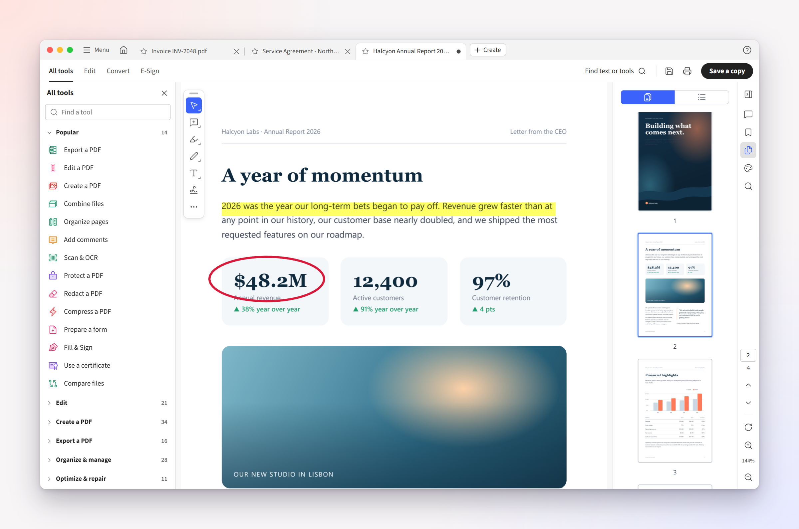
  </picture>
  <br />
  <sub>Tabs, the All tools panel, a floating toolbar and Acrobat's shortcuts. In light and dark.</sub>
</p>

<p align="center">
  <a href="#scan-straight-into-a-pdf">Scan</a> ·
  <a href="#sign-with-the-digital-id-you-already-have">Sign</a> ·
  <a href="#edit-and-annotate">Edit</a> ·
  <a href="#fill-in-forms-and-print">Forms &amp; print</a> ·
  <a href="#100-tools-beside-your-document">Tools</a> ·
  <a href="#paperwing-vs-acrobat">vs Acrobat</a> ·
  <a href="#download">Download</a> ·
  <a href="#faq">FAQ</a> ·
  <a href="#privacy">Privacy</a> ·
  <a href="#build-from-source">Build</a>
</p>

---

<table>
<tr>
<td width="33%" valign="top">

### 💸 Free, for real

Every feature, for everyone, forever. No trial, no "Pro" tier, no sign-in, no ads, no AI pop-ups.

</td>
<td width="33%" valign="top">

### 🔒 Private by design

Everything runs on your computer, even offline. No account, no analytics, no uploads.

</td>
<td width="33%" valign="top">

### ⌨️ Feels familiar

If you've used Acrobat, you already know it: All tools, Edit / Convert / E-Sign, the same shortcuts.

</td>
</tr>
<tr>
<td width="33%" valign="top">

### 🖨️ Scans from any scanner

USB, Wi-Fi and network scanners, even ones with no driver installed. Preview, crop, clean up, OCR.

</td>
<td width="33%" valign="top">

### ✍️ Signs like the pros

Digital IDs from Windows' certificate store, smart cards, USB tokens or the Mac Keychain. Valid in Acrobat.

</td>
<td width="33%" valign="top">

### ⚡ Fast and light

Opens in about a second, scrolls at 60 fps, never loses your work, and updates itself.

</td>
</tr>
</table>

> [!TIP]
> **New in 1.3:** scanning, signing with the certificates on your computer, copying highlighted text,
> and a fresh look for Home and About. 1.3.1 polishes the scan dialog and dropdowns.
> [All release notes →](https://github.com/rohanvijaykumar/paperwing/releases)

---

## Scan straight into a PDF

**Create ▸ From scanner** opens a dialog like the print dialog, and every scanner shows up once:
WIA and TWAIN on Windows, Image Capture on the Mac, and network scanners that need no driver
(AirScan, eSCL, Mopria).

- **Preview the glass and drag a box** around just the part you want.
- **Both sides**, even on a one-sided feeder. Presets for documents and photos, or save your own.
- **Clean-up built in**: straighten pages, crop to the paper, remove blank pages and backgrounds.
- **Searchable scans** with text recognition (OCR), in a new PDF or added to any PDF you have.

<p align="center">
  <picture>
    <source media="(prefers-color-scheme: dark)" srcset="docs/screenshots/scan-dark.png" />
    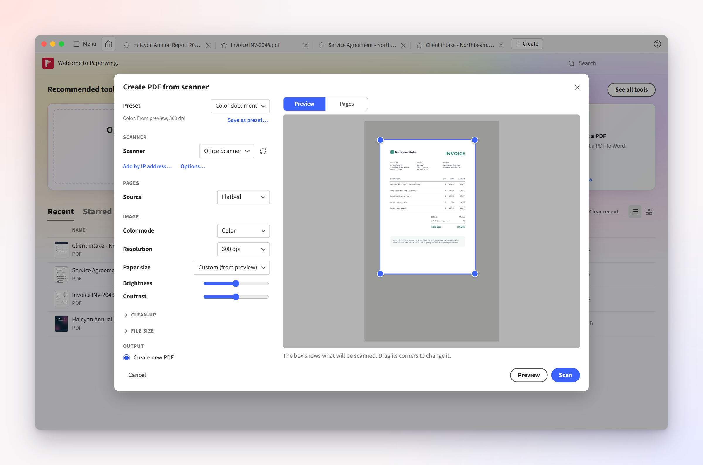
  </picture>
  <br />
  <sub>Preview on a flatbed, with the document found and boxed. Drag the corners to change it.</sub>
</p>

## Sign with the Digital ID you already have

**Use a certificate ▸ Digitally sign**, drag a box, and pick your Digital ID, just like in Acrobat.
Your private key never leaves Windows, the Keychain or the card: the system signs and asks for your
PIN itself. Signatures validate in Acrobat too.

- Windows certificate store, **smart cards and USB tokens**, the macOS Keychain, or a .pfx file
- Choose how the signature looks, lock the document after signing, add a trusted timestamp
- **Validate signatures** tells you who signed, whether anything changed since, and what it means

<table>
  <tr>
    <td width="50%">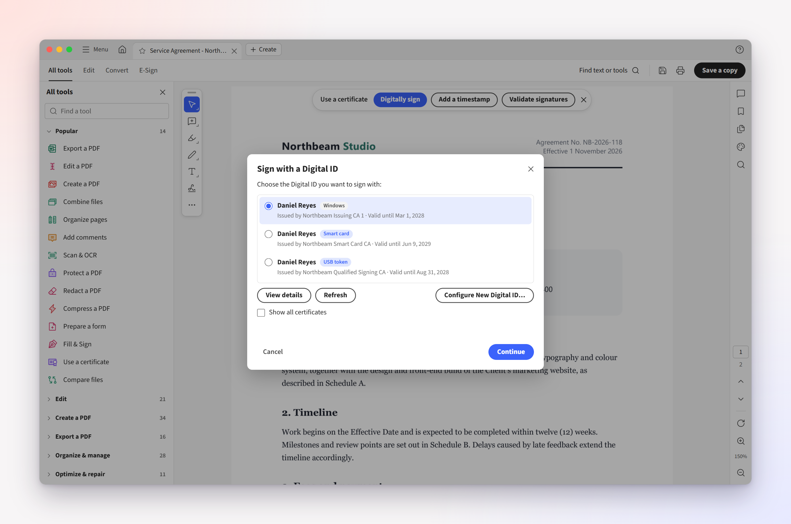</td>
    <td width="50%">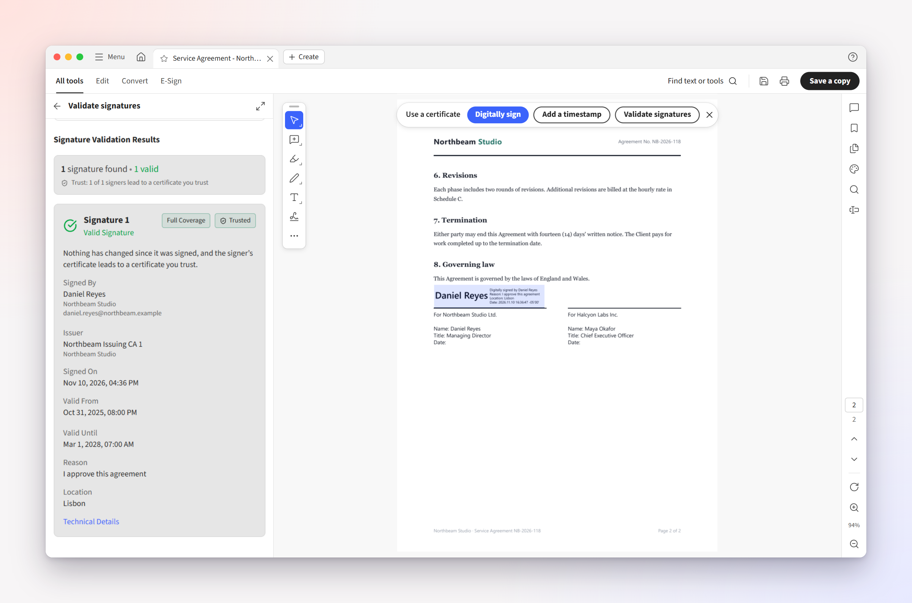</td>
  </tr>
  <tr>
    <td align="center"><sub><b>Sign</b> with an ID from Windows, a smart card or a token</sub></td>
    <td align="center"><sub><b>Validate</b> any signed PDF</sub></td>
  </tr>
</table>

## Edit and annotate

Change text and images right on the page, then mark it up with highlights, comments, shapes,
drawings, stamps and measurements. Redaction really deletes what's under it.

<table>
  <tr>
    <td width="50%">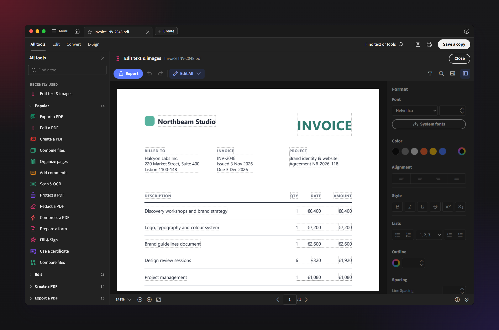</td>
    <td width="50%">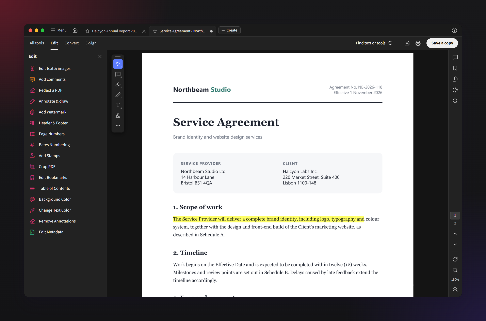</td>
  </tr>
  <tr>
    <td align="center"><sub><b>Edit text and images</b> in the page</sub></td>
    <td align="center"><sub><b>Annotate</b>, with single-key tools: H, V, S, U, D, X</sub></td>
  </tr>
</table>

## Fill in forms and print

Click a field and type, with a Form fields panel beside it; form scripts run (totals add up, dates
format), sandboxed. Print with a dialog that previews exactly what comes out.

<table>
  <tr>
    <td width="50%">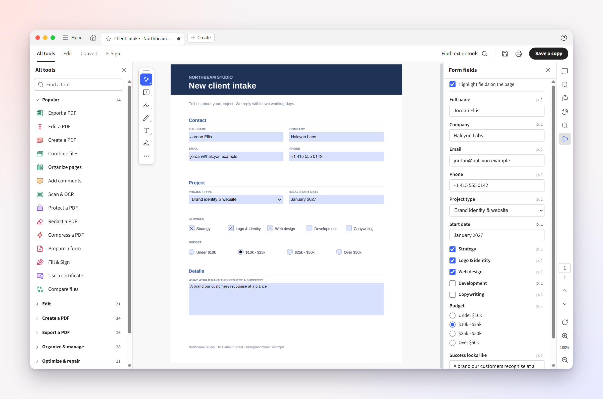</td>
    <td width="50%">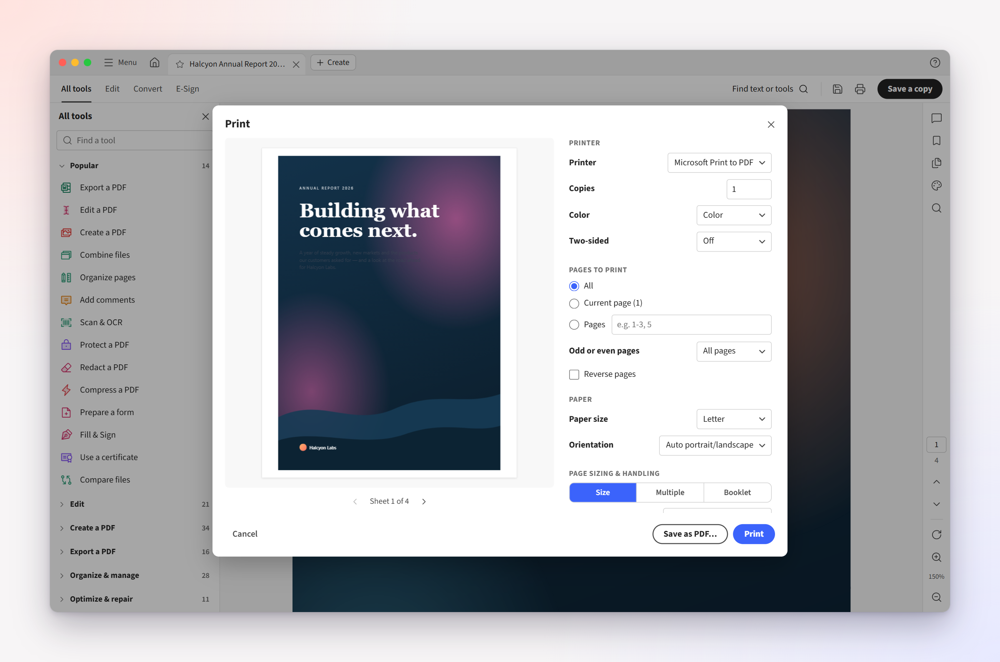</td>
  </tr>
  <tr>
    <td align="center"><sub><b>Forms</b>: fill in right on the page</sub></td>
    <td align="center"><sub><b>Print</b>: see exactly what prints</sub></td>
  </tr>
</table>

## 100+ tools beside your document

Convert, compress, OCR, merge, split, reorder, protect, redact, watermark, compare… Every tool opens
in a panel beside your document, works on the file you have open, and never changes your original:
results open in a new tab until you save.

<table>
  <tr>
    <td width="50%">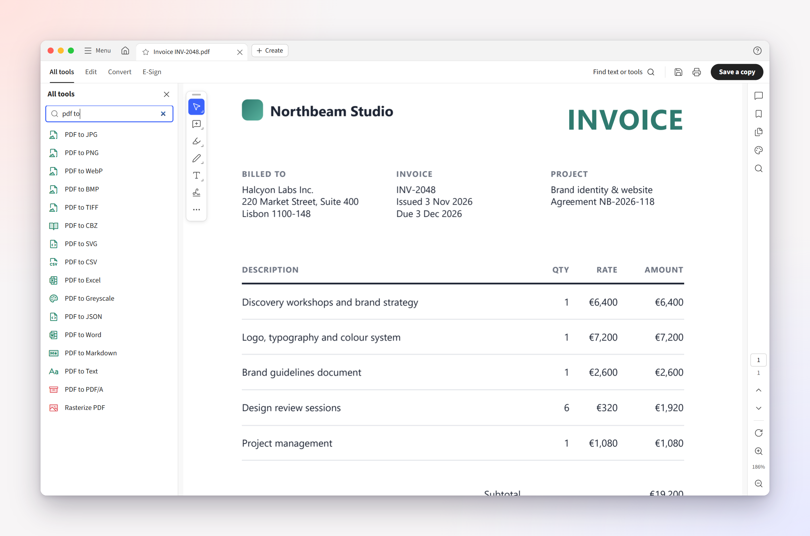</td>
    <td width="50%">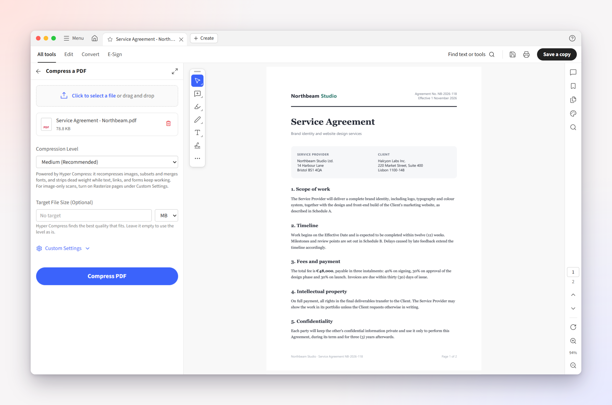</td>
  </tr>
  <tr>
    <td align="center"><sub><b>All tools</b>: search or browse, grouped like Acrobat's</sub></td>
    <td align="center"><sub><b>Tools beside the document</b>, results in a new tab</sub></td>
  </tr>
</table>

<details>
<summary><b>Every tool</b></summary>

- **Edit**: edit text and images, annotate, measure, redact, watermarks, headers and footers, page numbers, Bates numbering, bookmarks, stamps, crop
- **Convert**: PDF to Word, Excel, images, text, Markdown, JSON; Word, Excel, PowerPoint, images, ebooks, email, Markdown and 30+ formats to PDF
- **Scan**: create a PDF from a scanner, insert scanned pages, enhance scanned pages, OCR
- **Organize**: combine, split, reorder, rotate, insert, delete and extract pages; N-up, booklets, attachments, layers
- **E-Sign and forms**: fill in and sign, sign with a Digital ID, validate signatures, timestamps, create forms
- **Optimize and protect**: compress, repair, PDF/A, encrypt, remove restrictions, sanitize, flatten, compare

</details>

## A workspace you'll enjoy

A Home with your recent and starred files, tabs that reopen where you left off, a command palette
(<kbd>Ctrl</kbd>+<kbd>Shift</kbd>+<kbd>P</kbd>), read mode and full screen, and light and dark themes
that follow your system.

<table>
  <tr>
    <td width="50%">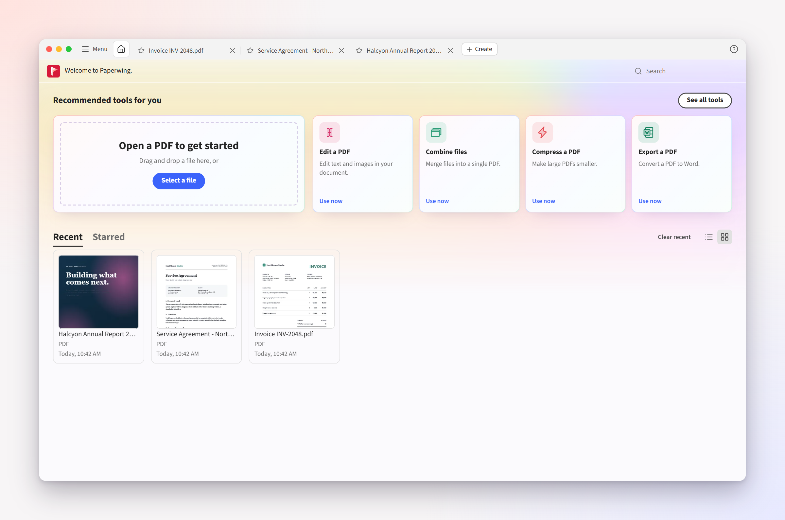</td>
    <td width="50%">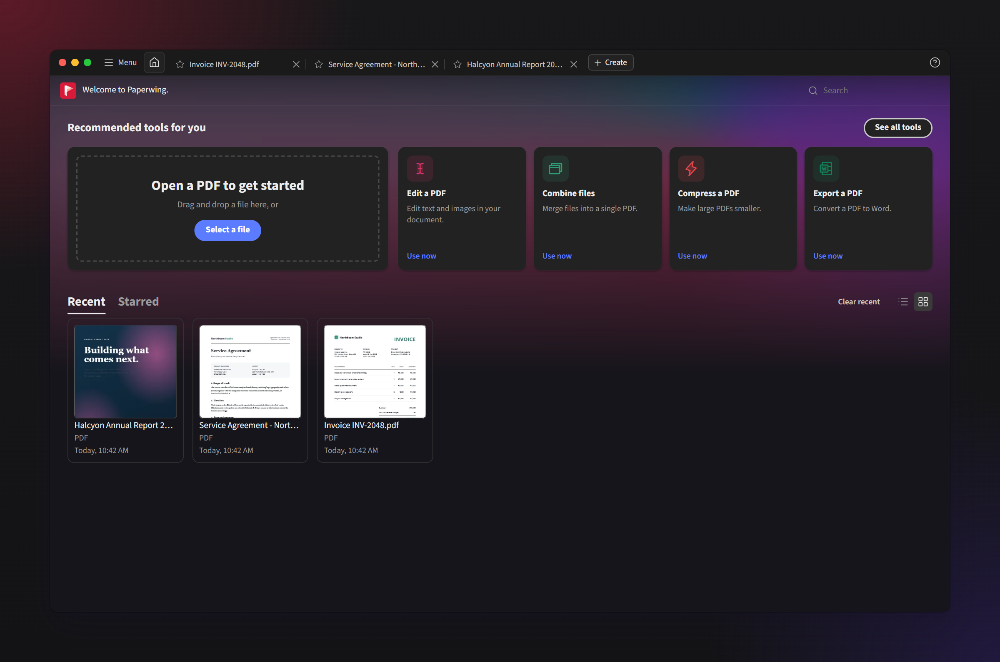</td>
  </tr>
  <tr>
    <td width="50%">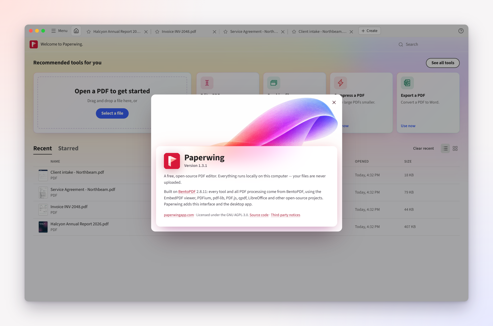</td>
    <td width="50%">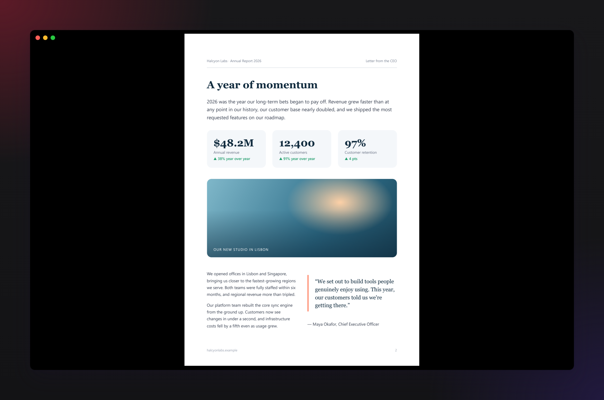</td>
  </tr>
  <tr>
    <td align="center" colspan="2"><sub><b>Home</b> in light and dark, <b>About</b>, and <b>full screen</b> (<kbd>Ctrl</kbd>+<kbd>L</kbd>)</sub></td>
  </tr>
</table>

<details>
<summary><b>More of the workspace</b></summary>

- Tabbed documents and a Home view with recent and starred files, each with a preview of its first page
- A searchable **All tools** sidebar with pinned and recently used tools on top
- Right rail with comments, bookmarks, thumbnails, find, page navigation, rotate and zoom to any percentage
- Read mode (<kbd>Ctrl</kbd>+<kbd>H</kbd>) and full screen (<kbd>Ctrl</kbd>+<kbd>L</kbd>)
- Documents reopen at the page and zoom you left them at; <kbd>Ctrl</kbd>+<kbd>Shift</kbd>+<kbd>T</kbd> reopens a closed tab
- Unsaved-change markers, session restore and recovery after a crash
- Batch tools run Compress, Flatten, PDF to Word and more on many files at once
- Native file dialogs and a real Save back to the original file
- PDF thumbnails in File Explorer (Windows), filled-in forms included
- Updates itself on Windows (installer), when you choose **Update**
- Portable mode on Windows: run it from a USB stick, settings stored beside it

</details>

---

## Paperwing vs Acrobat

|                                       | Paperwing          | Acrobat Pro  |
| ------------------------------------- | ------------------ | ------------ |
| Price                                 | **Free, forever**  | Subscription |
| Account required                      | **No**             | Yes          |
| Works offline                         | **Yes**¹           | Partly       |
| Upsell / AI pop-ups                   | **None**           | Frequent     |
| Scan to PDF, with OCR                 | **Yes**            | Yes          |
| Sign with smart cards and Digital IDs | **Yes**            | Yes          |
| Open source                           | **Yes (AGPL-3.0)** | No           |
| Portable (no install) on Windows      | **Yes**            | No           |
| Acrobat-style workspace and shortcuts | **Yes**            | —            |

<sub>¹ A few tools fetch their engine once on first use; see [Privacy](#privacy). Paperwing isn't
affiliated with Adobe ([Trademarks](#trademarks)) or with PaperWingPDF, a separate set of browser tools.</sub>

## Download

Get it from **[paperwingapp.com](https://paperwingapp.com/#download)**, which picks the right file for
your computer, or from **[Releases](https://github.com/rohanvijaykumar/paperwing/releases/latest)**.

| Platform                 | File                                       | Notes                                                  |
| ------------------------ | ------------------------------------------ | ------------------------------------------------------ |
| **Windows**, installer   | `Paperwing-Setup-<version>-x64.exe`        | Start-menu entry, opens your PDFs, updates itself      |
| **Windows**, portable    | `Paperwing-Portable-<version>-win-x64.zip` | Unzip and run `Paperwing.exe`; settings stay beside it |
| **macOS**, Apple Silicon | `Paperwing-<version>-mac-arm64.dmg`        | M1, M2, M3, M4 and later                               |
| **macOS**, Intel         | `Paperwing-<version>-mac-x64.dmg`          | Intel Macs                                             |

Paperwing isn't code-signed yet, so Windows and macOS warn the first time you open it.
[Installation](docs/INSTALL.md) has the one-time steps.

## FAQ

<details>
<summary><b>Is Paperwing the same as PaperWingPDF?</b></summary>

No. Paperwing is this desktop app for Windows and macOS. PaperWingPDF (paperwingpdf.com) is a
separate set of browser-based PDF tools by a different developer; the two projects aren't connected.
Paperwing is distributed only through [paperwingapp.com](https://paperwingapp.com) and this
repository's [Releases](https://github.com/rohanvijaykumar/paperwing/releases).

</details>

<details>
<summary><b>Which scanners work?</b></summary>

Almost all: anything with a WIA or TWAIN driver on Windows (64- and 32-bit), anything Image Capture
sees on the Mac, and network scanners that speak AirScan / eSCL / Mopria, which need no driver at all
(found automatically or added by IP address). For scanners that only work with their own app, such
as ScanSnap, **Import from a scanner app** picks up what that app saves.

</details>

<details>
<summary><b>Can I sign with my smart card, USB token or company certificate?</b></summary>

Yes. Paperwing lists the Digital IDs in the Windows certificate store or the macOS Keychain,
including the ones on smart cards and USB tokens, and the system signs with them, so the private key
never leaves the card or store. You can also use a .pfx / .p12 file or create a self-signed ID.

</details>

<details>
<summary><b>Do I need to install LibreOffice for Word, Excel and PowerPoint?</b></summary>

No. The first time you convert an Office file, Paperwing downloads the engine once (about 75 MB)
from this repository's Releases and checks it against a SHA-256 hash. It's left out of the installer
to keep the download small.

</details>

<details>
<summary><b>Does redaction actually remove the content?</b></summary>

Yes. The text and graphics under a redaction are deleted from the page, not just covered. To strip
metadata such as the author and title too, use the **Sanitize** tool.

</details>

<details>
<summary><b>Why does Windows or macOS warn me when I open it?</b></summary>

Paperwing isn't code-signed yet, and both systems warn about any unsigned app. The full source is
here, and you can [build it yourself](#build-from-source).

</details>

<details>
<summary><b>Does it work offline?</b></summary>

Yes. The exceptions are the one-time downloads listed under [Privacy](#privacy): the Office
conversion engine, and OCR in languages other than English. The other engines (PyMuPDF,
Ghostscript, coherentpdf, Tesseract with English…) come with the app.

</details>

## Keyboard shortcuts

Paperwing mirrors Acrobat's defaults (⌘ instead of Ctrl on macOS). The full list is in
**[docs/SHORTCUTS.md](docs/SHORTCUTS.md)** and in the app under **Help ▸ Keyboard shortcuts**.

<details>
<summary><b>A few favourites</b></summary>

| Action                                 | Shortcut                                                                                                                  |
| -------------------------------------- | ------------------------------------------------------------------------------------------------------------------------- |
| Open / Save / Save as                  | <kbd>Ctrl</kbd>+<kbd>O</kbd> · <kbd>Ctrl</kbd>+<kbd>S</kbd> · <kbd>Shift</kbd>+<kbd>Ctrl</kbd>+<kbd>S</kbd>               |
| Print                                  | <kbd>Ctrl</kbd>+<kbd>P</kbd>                                                                                              |
| Find / find next                       | <kbd>Ctrl</kbd>+<kbd>F</kbd> · <kbd>F3</kbd>                                                                              |
| Zoom in / out / fit page / actual size | <kbd>Ctrl</kbd>+<kbd>=</kbd> · <kbd>Ctrl</kbd>+<kbd>-</kbd> · <kbd>Ctrl</kbd>+<kbd>0</kbd> · <kbd>Ctrl</kbd>+<kbd>1</kbd> |
| Rotate view                            | <kbd>Shift</kbd>+<kbd>Ctrl</kbd>+<kbd>+</kbd> / <kbd>-</kbd>                                                              |
| Page thumbnails / tools panel          | <kbd>F4</kbd> · <kbd>Shift</kbd>+<kbd>F4</kbd>                                                                            |
| Highlight · comment · draw · text box  | <kbd>U</kbd> · <kbd>S</kbd> · <kbd>D</kbd> · <kbd>X</kbd>                                                                 |
| Read mode · full screen                | <kbd>Ctrl</kbd>+<kbd>H</kbd> · <kbd>Ctrl</kbd>+<kbd>L</kbd>                                                               |
| Search tools and commands              | <kbd>Shift</kbd>+<kbd>Ctrl</kbd>+<kbd>P</kbd>                                                                             |

</details>

## Privacy

All PDF processing happens on your computer. Paperwing has no accounts, analytics or telemetry, and
goes online only for updates and a few one-time engine downloads.

<details>
<summary><b>Every network request it makes</b></summary>

- **Updates:** a check of this repository's Releases every time Paperwing starts and every two hours
  while it's open (you can turn it off in **Preferences**). Nothing downloads until you choose to:
  the Windows installer then installs it; the portable build and macOS download the right file.
- **Word, Excel and PowerPoint to PDF** download the LibreOffice engine (about 75 MB, once) from this
  repository's Releases, checked against a SHA-256 hash.
- **Timestamps** (and digital signatures with one) contact the timestamp server you pick, sending only
  a hash of the document.
- **Signing with a certificate** and **Validate signatures** may fetch a certificate's issuers and
  revocation status from the addresses written in the certificate.
- **Scanning** talks only to your scanner: over USB, or on your local network for network scanners.
- **OCR** in English works offline. Other languages download their Tesseract data (a few MB each) from
  jsDelivr on first use; for non-Latin scripts, the font for the text layer comes from a CDN.
- **Fallback fonts** for text in fonts a document doesn't embed: the Latin one ships with Paperwing;
  others (Chinese, Japanese, Korean, Arabic, Hebrew) download from a CDN the first time they're needed,
  as does the Latin font in the **Edit text** tool.

</details>

## How Paperwing works

Paperwing is a fork of BentoPDF, whose tools process PDFs with open-source libraries compiled to
WebAssembly. It keeps BentoPDF's code unchanged and adds an Acrobat-style workspace and a desktop
app around it.

<details>
<summary><b>The layers</b></summary>

| Layer           | What it does                                                                                                                                  | Code                            |
| --------------- | --------------------------------------------------------------------------------------------------------------------------------------------- | ------------------------------- |
| **BentoPDF**    | All PDF work: the 100+ tools, plus the document viewer (EmbedPDF on PDFium), pdf-lib, PDF.js, qpdf, Tesseract OCR, LibreOffice and more       | `src/js`, `src/pages`, `public` |
| **Workspace**   | The Acrobat-style interface: tabs, Home, the searchable tools sidebar, the viewer workspace, forms, printing, scanning, signing, shortcuts    | `app.html`, `src/acro/`         |
| **Integration** | Restyles every BentoPDF tool page (light/dark, Acrobat look) and connects it to the workspace: passes the open file in and catches the result | `src/reskin/`, `reskin/`        |
| **Desktop app** | Electron: serves the built app from disk, native dialogs, printing, scanners and certificate stores (native helpers), portable mode           | `desktop/`                      |

When you pick a tool, Paperwing loads that BentoPDF tool page beside the document and hands it your
file; the result opens in a new tab or saves where you choose. Apart from two lines in
`vite.config.ts` and a handful of security fixes (listed in
[docs/UPSTREAM-PATCHES.md](docs/UPSTREAM-PATCHES.md)), BentoPDF's code is included unmodified, so new
BentoPDF releases merge in directly.

</details>

## Build from source

You need [Node.js](https://nodejs.org) 22 or newer.

```bash
git clone https://github.com/rohanvijaykumar/paperwing.git
cd paperwing
npm ci                      # BentoPDF dependencies
cd desktop && npm ci        # desktop shell dependencies
npm run dev                 # build the web app and launch Paperwing
```

Packaging, testing and releases are covered in **[docs/BUILDING.md](docs/BUILDING.md)**.

## Credits

Paperwing is built on **[BentoPDF](https://github.com/alam00000/bentopdf)** by
[Alam](https://github.com/alam00000) and contributors, which provides every tool and all of the PDF
processing. If Paperwing is useful to you, please consider
**[sponsoring BentoPDF's author](https://github.com/sponsors/alam00000)** ❤️

Third-party notices are in [NOTICE.md](NOTICE.md); BentoPDF's original README is in
[docs/BENTOPDF.md](docs/BENTOPDF.md).

## Contributing

Bug reports, ideas and pull requests are welcome: see **[CONTRIBUTING.md](CONTRIBUTING.md)**. If
Paperwing saves you an Acrobat subscription, a ⭐ helps other people find it.

## License

**[GNU Affero General Public License v3.0](LICENSE)**, the same as BentoPDF. You're free to use, study,
modify and share it; if you distribute a modified version, its source must be available under the
same license.

## Trademarks

Adobe and Acrobat are registered trademarks of Adobe Inc. Paperwing is not affiliated with, endorsed
by or sponsored by Adobe; the names are used only to describe what Paperwing is an alternative to.
Paperwing contains no Adobe code, logos, icons or fonts.

---

<p align="center">
  <br />
  <sub>Made by <a href="https://rohanvijaykumar.cv">Rohan Vijaykumar</a> and contributors · <a href="https://paperwingapp.com">paperwingapp.com</a></sub>
</p>
