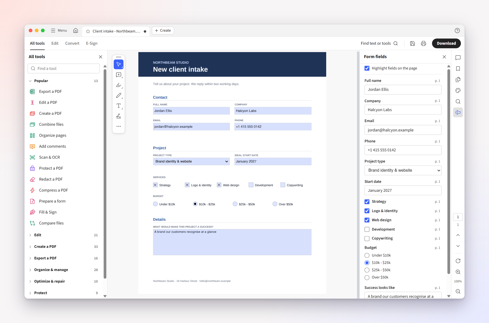
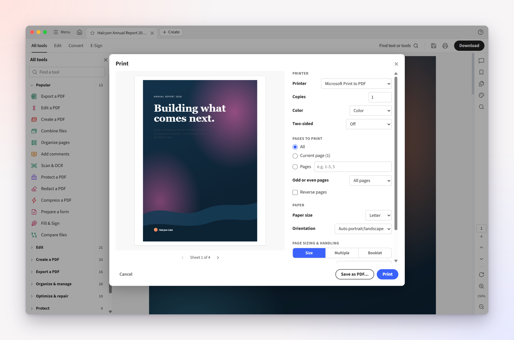
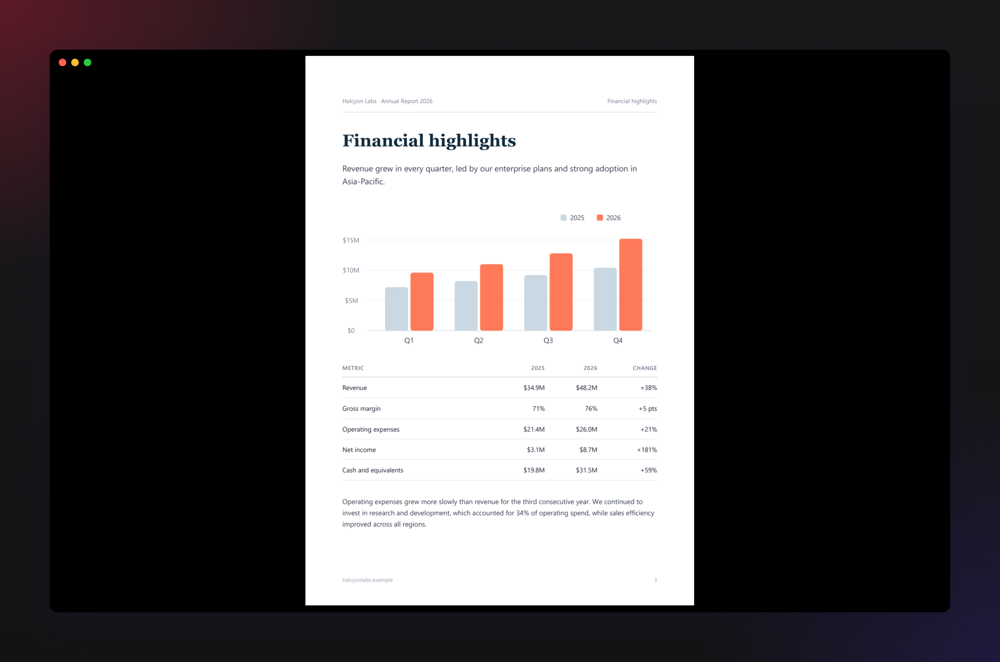

<div align="center">


# Paperwing

**The free, open-source desktop alternative to Adobe Acrobat for Windows and macOS.**

Edit, sign, convert, organize, compress and protect PDFs in a familiar desktop workspace,
offline, with no account, no subscription and no upsells.

**[Download at paperwingapp.com](https://paperwingapp.com)** · Built by [Rohan Vijaykumar](https://rohanvijaykumar.cv)

[](https://paperwingapp.com)
[](https://github.com/rohanvijaykumar/paperwing/releases/latest)
[](#download)
[](LICENSE)
[](https://github.com/alam00000/bentopdf)

<a href="https://www.producthunt.com/products/paperwing-2?embed=true&amp;utm_source=badge-featured&amp;utm_medium=badge&amp;utm_campaign=badge-paperwing-2" target="_blank" rel="noopener noreferrer"></a> <a href="https://alternativeto.net/software/paperwing-pdf/about/?utm_source=badge&amp;utm_medium=referral" target="_blank" rel="noopener noreferrer"></a> <a href="https://www.saashub.com/paperwing-app?utm_source=badge&amp;utm_campaign=badge&amp;utm_content=paperwing-app&amp;badge_variant=color&amp;badge_kind=approved" target="_blank" rel="noopener noreferrer"></a>

<br />


</div>

## Why Paperwing?

If you've used Acrobat, you already know Paperwing: the same tabbed workspace, **All tools** panel,
**Edit / Convert / E-Sign** tabs, floating toolbar and keyboard shortcuts. Without the sign-in
prompts, trial pop-ups, AI overlays or monthly bill. Every feature is free, and your files never
leave your computer.

|                                       | Paperwing          | Acrobat Pro  |
| ------------------------------------- | ------------------ | ------------ |
| Price                                 | **Free, forever**  | Subscription |
| Account required                      | **No**             | Yes          |
| Works offline                         | **Yes**¹           | Partly       |
| Upsell / AI pop-ups                   | **None**           | Frequent     |
| Open source                           | **Yes (AGPL-3.0)** | No           |
| Portable (no install) on Windows      | **Yes**            | No           |
| Acrobat-style workspace and shortcuts | **Yes**            | —            |

<sub>¹ A few tools fetch their engine once on first use; see [Privacy](#privacy). Paperwing isn't
affiliated with Adobe ([Trademarks](#trademarks)) or with PaperWingPDF, a separate set of browser tools.</sub>

## New in 1.2.4

- **Fill in forms right on the page**: click a field and type, with a Form fields panel beside it
- **Form scripts run**, sandboxed: totals add up, dates format, entries are checked
- **A print dialog like Acrobat's**, with a preview of exactly what will print
- **Full screen**: one page at a time on black (<kbd>Ctrl</kbd>+<kbd>L</kbd>)
- Shortcuts follow your keyboard layout, and dragging PDFs in from File Explorer works

[All release notes →](https://github.com/rohanvijaykumar/paperwing/releases)

## Features

- 🧰 **100+ tools from [BentoPDF](https://github.com/alam00000/bentopdf)**, each opening right beside your document
- 🔒 **Private by default**: everything runs locally, with no account, telemetry or uploads
- ⌨️ **Acrobat's shortcuts**, including single-key tools (H, V, S, U, D, X), plus a command palette (<kbd>Ctrl</kbd>+<kbd>Shift</kbd>+<kbd>P</kbd>)
- 📝 **Forms and printing** that work like Acrobat's: fill in on the page, print with a preview
- ⚡ **Fast and light**: opens in about a second and scrolls at a steady 60 fps
- 💾 **Never lose work**: unsaved-change markers, session restore and recovery after a crash
- 🌗 **Light and dark themes** that follow your system
- 🖼️ **PDF thumbnails in File Explorer** (Windows), filled-in forms included

<details>
<summary><b>Every tool</b></summary>

- **Edit**: edit text and images, annotate, redact, watermarks, headers and footers, page numbers, Bates numbering, bookmarks, stamps, crop
- **Convert**: PDF to Word, Excel, images, text, Markdown, JSON; Word, Excel, PowerPoint, images, ebooks, email, Markdown and 30+ formats to PDF
- **Organize**: combine, split, reorder, rotate, insert, delete and extract pages; N-up, booklets, attachments, layers
- **E-Sign and forms**: fill in and sign, digital certificates, signature validation, timestamps, create forms
- **Optimize and protect**: compress, OCR, repair, PDF/A, encrypt, remove restrictions, sanitize, flatten, compare

</details>

<details>
<summary><b>More of the workspace</b></summary>

- Tabbed documents and a Home view with recent and starred files, each with a preview of its first page
- A searchable **All tools** sidebar, grouped like Acrobat's, with pinned and recently used tools on top
- Right rail with comments, bookmarks, thumbnails, find, page navigation, rotate and zoom to any percentage
- Read mode (<kbd>Ctrl</kbd>+<kbd>H</kbd>) and full screen (<kbd>Ctrl</kbd>+<kbd>L</kbd>)
- Documents reopen at the page and zoom you left them at; <kbd>Ctrl</kbd>+<kbd>Shift</kbd>+<kbd>T</kbd> reopens a closed tab
- Batch tools run Compress, Flatten, PDF to Word and more on many files at once
- Tools never change your original: results open in a new tab until you save
- Native file dialogs and a real Save back to the original file
- Updates itself on Windows (installer), when you choose **Update**
- Portable mode on Windows: run it from a USB stick, settings stored beside it

</details>

## Screenshots

<table>
  <tr>
    <td width="50%"><br /><sub><b>Forms</b>: fill in right on the page</sub></td>
    <td width="50%"><br /><sub><b>Print</b>: with a preview of exactly what prints</sub></td>
  </tr>
  <tr>
    <td><br /><sub><b>Home</b>: recent and starred files with page previews</sub></td>
    <td><br /><sub><b>Dark mode</b>: follows your system</sub></td>
  </tr>
</table>

<details>
<summary><b>More screenshots</b></summary>

<table>
  <tr>
    <td width="50%"><br /><sub><b>All tools</b>: search and browse every tool</sub></td>
    <td width="50%"><br /><sub><b>Tools beside the document</b>: results open in a new tab</sub></td>
  </tr>
  <tr>
    <td><br /><sub><b>Edit text and images</b>: right in the page</sub></td>
    <td><br /><sub><b>Full screen</b>: one page at a time</sub></td>
  </tr>
</table>

</details>

## Download

Get it from **[paperwingapp.com](https://paperwingapp.com/#download)**, which picks the right file for
your computer, or from **[Releases](https://github.com/rohanvijaykumar/paperwing/releases/latest)**.

| Platform                 | File                                       | Notes                                                  |
| ------------------------ | ------------------------------------------ | ------------------------------------------------------ |
| **Windows**, installer   | `Paperwing-Setup-<version>-x64.exe`        | Start-menu entry, opens your PDFs, updates itself      |
| **Windows**, portable    | `Paperwing-Portable-<version>-win-x64.zip` | Unzip and run `Paperwing.exe`; settings stay beside it |
| **macOS**, Apple Silicon | `Paperwing-<version>-mac-arm64.dmg`        | M1, M2, M3, M4 and later                               |
| **macOS**, Intel         | `Paperwing-<version>-mac-x64.dmg`          | Intel Macs                                             |

Paperwing isn't code-signed yet, so Windows and macOS warn the first time you open it.
[Installation](docs/INSTALL.md) has the one-time steps.

## FAQ

<details>
<summary><b>Is Paperwing the same as PaperWingPDF?</b></summary>

No. Paperwing is this desktop app for Windows and macOS. PaperWingPDF (paperwingpdf.com) is a
separate set of browser-based PDF tools by a different developer; the two projects aren't connected.
Paperwing is distributed only through [paperwingapp.com](https://paperwingapp.com) and this
repository's [Releases](https://github.com/rohanvijaykumar/paperwing/releases).

</details>

<details>
<summary><b>Do I need to install LibreOffice for Word, Excel and PowerPoint?</b></summary>

No. The first time you convert an Office file, Paperwing downloads the engine once (about 75 MB)
from this repository's Releases and checks it against a SHA-256 hash. It's left out of the installer
to keep the download small.

</details>

<details>
<summary><b>Does redaction actually remove the content?</b></summary>

Yes. The text and graphics under a redaction are deleted from the page, not just covered. To strip
metadata such as the author and title too, use the **Sanitize** tool.

</details>

<details>
<summary><b>Why does Windows or macOS warn me when I open it?</b></summary>

Paperwing isn't code-signed yet, and both systems warn about any unsigned app. The full source is
here, and you can [build it yourself](#build-from-source).

</details>

<details>
<summary><b>Does it work offline?</b></summary>

Yes. The exceptions are the one-time downloads listed under [Privacy](#privacy): the Office
conversion engine, and OCR in languages other than English. The other engines (PyMuPDF,
Ghostscript, coherentpdf, Tesseract with English…) come with the app.

</details>

## Keyboard shortcuts

Paperwing mirrors Acrobat's defaults (⌘ instead of Ctrl on macOS). The full list is in
**[docs/SHORTCUTS.md](docs/SHORTCUTS.md)** and in the app under **Help ▸ Keyboard shortcuts**.

<details>
<summary><b>A few favourites</b></summary>

| Action                                 | Shortcut                                                                                                                  |
| -------------------------------------- | ------------------------------------------------------------------------------------------------------------------------- |
| Open / Save / Save as                  | <kbd>Ctrl</kbd>+<kbd>O</kbd> · <kbd>Ctrl</kbd>+<kbd>S</kbd> · <kbd>Shift</kbd>+<kbd>Ctrl</kbd>+<kbd>S</kbd>               |
| Print                                  | <kbd>Ctrl</kbd>+<kbd>P</kbd>                                                                                              |
| Find / find next                       | <kbd>Ctrl</kbd>+<kbd>F</kbd> · <kbd>F3</kbd>                                                                              |
| Zoom in / out / fit page / actual size | <kbd>Ctrl</kbd>+<kbd>=</kbd> · <kbd>Ctrl</kbd>+<kbd>-</kbd> · <kbd>Ctrl</kbd>+<kbd>0</kbd> · <kbd>Ctrl</kbd>+<kbd>1</kbd> |
| Rotate view                            | <kbd>Shift</kbd>+<kbd>Ctrl</kbd>+<kbd>+</kbd> / <kbd>-</kbd>                                                              |
| Page thumbnails / tools panel          | <kbd>F4</kbd> · <kbd>Shift</kbd>+<kbd>F4</kbd>                                                                            |
| Highlight · comment · draw · text box  | <kbd>U</kbd> · <kbd>S</kbd> · <kbd>D</kbd> · <kbd>X</kbd>                                                                 |
| Read mode · full screen                | <kbd>Ctrl</kbd>+<kbd>H</kbd> · <kbd>Ctrl</kbd>+<kbd>L</kbd>                                                               |
| Search tools and commands              | <kbd>Shift</kbd>+<kbd>Ctrl</kbd>+<kbd>P</kbd>                                                                             |

</details>

## Privacy

All PDF processing happens on your computer. Paperwing has no accounts, analytics or telemetry, and
goes online only for updates and a few one-time engine downloads.

<details>
<summary><b>Every network request it makes</b></summary>

- **Updates:** a check of this repository's Releases every time Paperwing starts and every two hours
  while it's open (you can turn it off in **Preferences**). Nothing downloads until you choose to:
  the Windows installer then installs it; the portable build and macOS download the right file.
- **Word, Excel and PowerPoint to PDF** download the LibreOffice engine (about 75 MB, once) from this
  repository's Releases, checked against a SHA-256 hash.
- **Timestamps** (and digital signatures with one) contact the timestamp server you pick, sending only
  a hash of the document.
- **OCR** in English works offline. Other languages download their Tesseract data (a few MB each) from
  jsDelivr on first use; for non-Latin scripts, the font for the text layer comes from a CDN.
- **Fallback fonts** for text in fonts a document doesn't embed: the Latin one ships with Paperwing;
  others (Chinese, Japanese, Korean, Arabic, Hebrew) download from a CDN the first time they're needed,
  as does the Latin font in the **Edit text** tool.

</details>

## How Paperwing works

Paperwing is a fork of BentoPDF, whose tools process PDFs with open-source libraries compiled to
WebAssembly. It keeps BentoPDF's code unchanged and adds an Acrobat-style workspace and a desktop
app around it.

<details>
<summary><b>The layers</b></summary>

| Layer           | What it does                                                                                                                                  | Code                            |
| --------------- | --------------------------------------------------------------------------------------------------------------------------------------------- | ------------------------------- |
| **BentoPDF**    | All PDF work: the 100+ tools, plus the document viewer (EmbedPDF on PDFium), pdf-lib, PDF.js, qpdf, Tesseract OCR, LibreOffice and more       | `src/js`, `src/pages`, `public` |
| **Workspace**   | The Acrobat-style interface: tabs, Home, the searchable tools sidebar, the viewer workspace, forms, printing, shortcuts, preferences          | `app.html`, `src/acro/`         |
| **Integration** | Restyles every BentoPDF tool page (light/dark, Acrobat look) and connects it to the workspace: passes the open file in and catches the result | `src/reskin/`, `reskin/`        |
| **Desktop app** | Electron: serves the built app from disk, native open/save dialogs, printing, file associations, launch screen, portable mode                 | `desktop/`                      |

When you pick a tool, Paperwing loads that BentoPDF tool page beside the document and hands it your
file; the result opens in a new tab or saves where you choose. Apart from two lines in
`vite.config.ts` and a handful of security fixes (listed in
[docs/UPSTREAM-PATCHES.md](docs/UPSTREAM-PATCHES.md)), BentoPDF's code is included unmodified, so new
BentoPDF releases merge in directly.

</details>

## Build from source

You need [Node.js](https://nodejs.org) 22 or newer.

```bash
git clone https://github.com/rohanvijaykumar/paperwing.git
cd paperwing
npm ci                      # BentoPDF dependencies
cd desktop && npm ci        # desktop shell dependencies
npm run dev                 # build the web app and launch Paperwing
```

Packaging, testing and releases are covered in **[docs/BUILDING.md](docs/BUILDING.md)**.

## Credits

Paperwing is built on **[BentoPDF](https://github.com/alam00000/bentopdf)** by
[Alam](https://github.com/alam00000) and contributors, which provides every tool and all of the PDF
processing. If Paperwing is useful to you, please consider
**[sponsoring BentoPDF's author](https://github.com/sponsors/alam00000)** ❤️

Third-party notices are in [NOTICE.md](NOTICE.md); BentoPDF's original README is in
[docs/BENTOPDF.md](docs/BENTOPDF.md).

## Contributing

Bug reports, ideas and pull requests are welcome: see **[CONTRIBUTING.md](CONTRIBUTING.md)**.

## License

**[GNU Affero General Public License v3.0](LICENSE)**, the same as BentoPDF. You're free to use, study,
modify and share it; if you distribute a modified version, its source must be available under the
same license.

## Trademarks

Adobe and Acrobat are registered trademarks of Adobe Inc. Paperwing is not affiliated with, endorsed
by or sponsored by Adobe; the names are used only to describe what Paperwing is an alternative to.
Paperwing contains no Adobe code, logos, icons or fonts.
